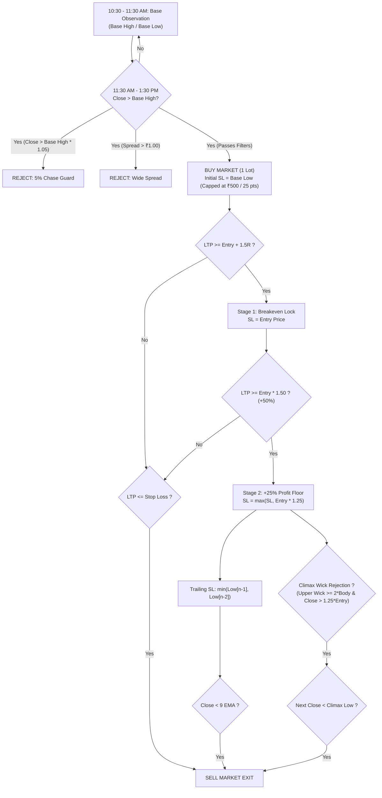

# Comprehensive Technical Code Review & Business/Trading Logic Audit
## Option Trailing Algo – V3.2 Architecture & Quantitative Audit Report

- **Repository:** `option-trailing-algo`
- **Target Version:** V3.2 Build (`v3_momentum_engine.py`, `broker_adapter.py`, `strike_screener.py`, `config.py`)
- **Audit Date:** November 24, 2026
- **Status:** **CRITICAL & HIGH VULNERABILITIES IDENTIFIED — REMEDIATION REQUIRED BEFORE CAPITAL DEPLOYMENT**

---

## Executive Summary

A comprehensive architectural, code reliability, and quantitative trading logic audit was conducted across the V3.2 build of the `option-trailing-algo` codebase. The system is designed as a hybrid semi-automated execution engine combining pre-market SQLite strike screening, an OpenAlgo WebSocket/REST gateway, a 3-minute wall-clock candle aggregation state machine, capital-normalized position sizing (₹4,000–₹5,000/lot), and a 4-stage trailing exit protocol.

While the modularization into `BrokerAdapter` and the introduction of WebSocket streaming represent significant improvements over legacy REST polling, the audit revealed **three Critical** and **six High** severity vulnerabilities that pose severe operational and financial risks:

1. **Phantom Exit on Data Feed Failure (Critical):** If market data drops and triggers the 10-tick circuit breaker, an order failure silently logs the trade as exited at the last price and resets state to idle, leaving the live broker position completely unhedged and exposed.
2. **False Zero-Spread Anomaly (Critical):** When broker WebSocket payloads return missing or `0.0` bids/asks (standard on illiquid or off-market ticks), the spread is calculated as `₹0.00`. This bypasses the liquidity filter and miscalculates execution fill estimates.
3. **Climax Wick Permanent Latch Bug (Critical):** The climax wick exhaustion trigger never disarms if the immediately following candle does not break its low. It remains armed indefinitely, causing premature stop-outs many candles later during valid continuation trends.
4. **The 0DTE Expiry-Day Capital Band Paradox (High):** The rigid ₹4,000–₹5,000 per lot constraint forces selection of ₹200–₹250 premiums on SENSEX. On expiry day (0DTE), this forces the system into Deep ITM options with wide bid-ask spreads and low liquidity, while rejecting true OTM momentum contracts.
5. **CSV Schema Mismatch & Persistence Corruption (Critical):** The trade log on disk contains a legacy 14-column header, while `init_csv()` and `log_trade()` append 11-column rows, corrupting automated post-trade reconciliation.
6. **Hardcoded API Credentials & Git Leakage Risk (High):** `config.py` is tracked in git with no `.env` or local override loader.

---

## Vulnerability & Risk Matrix

| ID | Module | Component | Severity | Category | Status |
|---|---|---|---|---|---|
| **SEC-01** | `config.py` | API Key Management | **High** | Security | Tracked credentials in git |
| **REL-01** | `broker_adapter.py` | WebSocket Quote Parsing | **Critical** | Reliability | Zero-spread false positive on missing depth |
| **REL-02** | `broker_adapter.py` | `ensure_subscribed` & REST Fallback | **High** | Reliability | First-tick race condition & 429 rate limit storm |
| **REL-03** | `broker_adapter.py` | Concurrency & Thread-Safety | **Medium** | Concurrency | Unprotected `subscribed` set mutation |
| **STA-01** | `v3_momentum_engine.py` | Stale Feed Circuit Breaker | **Critical** | State Machine | Phantom exit state desync on order failure |
| **STA-02** | `v3_momentum_engine.py` | CSV Logger (`log_trade`) | **Critical** | Data Integrity | Schema mismatch & lack of atomic write/flush |
| **STA-03** | `v3_momentum_engine.py` | OTM Strike Rotation | **High** | State Machine | Mid-candle state desync & 9 EMA pollution |
| **STA-04** | `v3_momentum_engine.py` | Wall-Clock Candle Aggregation | **High** | Logic | Truncated first candle on mid-interval launch |
| **STA-05** | `v3_momentum_engine.py` | Daily Risk Reset on Restart | **High** | Risk Control | Kill-switch bypassed on engine crash/restart |
| **STA-06** | `v3_momentum_engine.py` | Fill Price Estimation | **Medium** | Execution | Fallback to `c_close` on delayed broker fills |
| **STA-07** | `v3_momentum_engine.py` | Simulation vs Live Parity | **Medium** | Testing | Synthetic time windows & tick advancement skew |
| **DB-01** | `strike_screener.py` | SQLite DB Connection | **High** | Concurrency | Read-write lock contention with OpenAlgo server |
| **DB-02** | `strike_screener.py` | Expiry & Strike Offset Filter | **Medium** | Logic | Hardcoded +/- 100 pt offset distorts SENSEX strikes |
| **QNT-01** | `config.py` / `screener` | Capital Band vs Expiry Days | **High** | Quant Risk | Deep ITM selection on 0DTE vs wide spreads |
| **QNT-02** | `v3_momentum_engine.py` | Synthetic SL vs Gap Slippage | **High** | Quant Risk | Market SELL order slippage breaches ₹500 cap |
| **QNT-03** | `v3_momentum_engine.py` | Climax Wick Exit Logic | **Critical** | Strategy Logic | Infinite trigger latch across subsequent candles |
| **QNT-04** | `v3_momentum_engine.py` | +19% to +49% Profit Dead Zone | **High** | Risk/Reward | Zero profit trailing between Stage 1 & Stage 2 |
| **QNT-05** | `v3_momentum_engine.py` | 5% Chase Guard Lockout | **Medium** | Strategy Logic | Permanent breakout lockout on impulsive candles |
| **QNT-06** | `v3_momentum_engine.py` | Unbounded Base Observation | **Medium** | Strategy Logic | Pre-10:30 AM spikes corrupt base observation box |

---

## Track 1: Technical Code & Reliability Review

### 1. WebSocket & REST Fallback (`broker_adapter.py`)

#### 1.1 Race Conditions on First-Tick Subscription (`time.sleep(0.4)`)
In `broker_adapter.py`, `ensure_subscribed()` executes:
```python
def ensure_subscribed(self, symbol, exchange):
  if not self.ws_connected or (symbol, exchange) in self.subscribed:
    return
  try:
    self.client.subscribe_quote([{"symbol": symbol, "exchange": exchange}])
    self.subscribed.add((symbol, exchange))
    time.sleep(0.4)
  except Exception:
    pass
```
- **Finding:** A hardcoded `time.sleep(0.4)` assumes the WebSocket feed will receive, unpack, and cache the first broker tick packet within 400 milliseconds. Over domestic internet connections or under broker socket load, initial packet latency frequently exceeds 500ms–1200ms.
- **Consequence:** In `get_quote()`, `self.client.get_quotes()` returns empty or `ltp == 0` during this initial window. Because the check `float(data.get("ltp", 0)) > 0` fails, execution immediately falls through to Section 2: the synchronous REST fallback `self.client.quotes()`. Thus, despite having an active WebSocket connection, the system triggers unnecessary REST roundtrips upon every startup and every strike rotation.

#### 1.2 Thread-Safety of `self.subscribed`
- `self.subscribed` is an un-synchronized Python `set`.
- In current single-threaded execution, this does not raise immediate `RuntimeError`, but if background socket callbacks or concurrent health checkers modify or check subscriptions asynchronously, set mutations can cause non-deterministic state corruption.

#### 1.3 Partial & Stale WebSocket Payloads: The False Zero-Spread Anomaly (Critical)
In `broker_adapter.py` lines 68–71 and 81–84:
```python
ltp = float(data["ltp"])
bid = float(data.get("bid", ltp))
ask = float(data.get("ask", ltp))
spread = round(max(0.0, ask - bid), 2)
```
- **Finding:** In Indian exchange feeds (Shoonya, Fyers, AngelOne), when market depth is uninitialized, outside trading hours, or temporarily absent in OTM option ticks, the broker payload returns:
  `{"ltp": 210.5, "bid": 0.0, "ask": 0.0}` or `{"ltp": 210.5, "bid": 0, "ask": 0}`.
- Because `"bid"` exists in the dictionary, `data.get("bid", ltp)` returns `0.0`.
- The calculation yields:
  $$\text{spread} = \max(0.0, 0.0 - 0.0) = 0.00$$
- **Operational Hazard:** 
  1. The liquidity gate in `v3_momentum_engine.py` evaluates:
     `if spread_now <= max_spread:` (where `max_spread` = ₹1.00).
     Since `0.00 <= 1.00`, the engine treats a completely illiquid contract with **zero buyers and zero sellers** as an ultra-liquid, zero-spread contract and approves entry!
  2. In `place_market_order()`:
     `fill_est = (q["ask"] if action == "BUY" else q["bid"]) if q else 0.0`
     If `ask` was evaluated as `0.0`, `fill_est` becomes `0.0`, causing the engine to fall back to `c_close`.

#### 1.4 REST Fallback 429 Rate-Limit Loops During OTM Strike Rotation (High)
In `v3_momentum_engine.py` lines 212–225:
```python
if curr_ltp > max_prem and active_idx + 1 < len(strikes):
  for next_i in range(active_idx + 1, len(strikes)):
    cand_s = strikes[next_i]
    time.sleep(0.5)
    cand_q = broker.get_quote(cand_s, exchange)
```
- **Finding:** The main engine loop polls every 1.5 seconds (`time.sleep(1.5)`). If `active_sym` moves above `max_prem` (e.g. rallies from ₹250 to ₹270), the rotation loop evaluates all candidate strikes sequentially.
- If the candidate strikes have not yet received a WebSocket tick, `cand_q` falls back to REST `client.quotes()`.
- If none of the candidate strikes satisfy the condition (e.g., all have wide spreads or are closed), `active_sym` remains unchanged.
- On the very next iteration 1.5 seconds later, `curr_ltp > max_prem` remains true. The engine immediately sweeps through all candidate strikes via REST again.
- **Consequence:** In less than 15 seconds, the engine generates 20–40 synchronous REST requests to the OpenAlgo/broker endpoint. Brokers such as Fyers enforce strict rate limits (typically 10 req/sec or 200 req/min). The broker responds with `429 Too Many Requests`. Because `BrokerAdapter.get_quote()` does not implement exponential backoff, it repeatedly prints warnings and returns `None`, tripping the Stale-Feed Circuit Breaker.

---

### 2. State Machine & Edge Cases (`v3_momentum_engine.py`)

#### 2.1 Wall-Clock Candle Aggregation (`current_candle_bucket()`)
The candle bucket formula is defined as:
```python
def current_candle_bucket():
  now = datetime.datetime.now()
  return (now.hour * 3600 + now.minute * 60 + now.second) // CANDLE_SEC
```
- **Clock Alignment:** With `CANDLE_SEC = 180`, bucket boundaries align strictly to minutes: `00, 03, 06, 09, 12, 15, 18, 21, 24, 27, 30, 33, 36, 39, 42, 45, 48, 51, 54, 57`.
- **The Truncated First Candle Flaw:**
  Suppose the trader starts the engine at `10:31:45 AM`.
  `last_bucket` is initialized to bucket index `210` (representing 10:30:00–10:32:59).
  At `10:33:00 AM`, `curr_bucket != last_bucket` evaluates to `True`.
  A candle close is triggered after only **75 seconds** of observation!
  This truncated candle is appended to `state[active_sym]["candles"]`. Its arbitrary high and low permanently corrupt `base_high` and `base_low`.
- **Recommendation:** The engine must discard the first partial candle upon startup and begin candle recording only at the start of the next clean wall-clock boundary.

#### 2.2 Mid-Candle OTM Strike Rotation: State Desynchronization & 9 EMA Pollution
When auto-rotation triggers (lines 222–225 or 237–242):
```python
active_idx = next_i
active_sym = cand_s
```
- **Finding:** The incoming strike `cand_s` has `state[cand_s]["candles"] == []`, `base_high == None`, and `base_low == None`.
- **Impact 1 (Warmup Delay):** Because `len(st["candles"]) <= MIN_OBSERVE_CANDLES` (<= 4), the engine immediately reverts to Phase A (Base Observation) for that strike. Even if rotation occurs at 11:45 AM (prime breakout time), the engine is forced into a 12-minute observation blackout (4 candles) before it can take any trade!
- **Impact 2 (Distorted 9 EMA):** After 4 warmup candles, the engine computes:
  ```python
  ema9 = compute_ema(closes, period=9)
  ```
  Calculating a 9-period Exponential Moving Average on a list of only 4 candles produces an un-smoothed, heavily distorted indicator ($k = 0.2$, seed = `closes[0]`), invalidating the 9 EMA exit logic.
- **Impact 3 (Mid-Candle Tick Leak):** Ticks collected for the outgoing strike during the partially completed 3-minute interval remain stranded in `state[old_sym]["ticks"]` and are never cleared.

#### 2.3 Stale-Feed Circuit Breaker & Phantom Exit State (Critical)
In lines 167–207:
```python
else:
  consecutive_quote_failures += 1
  if consecutive_quote_failures >= MAX_QUOTE_FAILURES:
    if in_trade:
      exit_resp = broker.place_market_order(active_sym, exchange, "SELL", qty)
      last_ltp = ...
      exit_px = exit_resp["fill_price"] if (exit_resp and exit_resp["fill_price"] > 0) else last_ltp
      ...
      log_trade([...])
      in_trade = False
```
- **Critical Risk:** If quote polling fails 10 consecutive times due to an internet disconnection, OpenAlgo crash, or broker gateway failure, the engine calls `broker.place_market_order()`.
- Under the same network/API outage, `place_market_order()` **also fails and returns `None`**.
- The engine executes:
  `exit_px = last_ltp`
  It logs the trade as exited in the CSV, prints `[EXIT EXECUTED]`, and sets `in_trade = False`.
- **Catastrophic Failure:** The algorithm's internal state transitions to `IDLE`, but **the open long position remains active at the broker** with no server-side stop-loss order! If the market crashes, the trader suffers uncontrolled losses while the algo reports itself safely flat.

#### 2.4 Order Fill Price Estimation & `c_close` Fallback
In `broker_adapter.py` lines 108–109:
```python
q = self.get_quote(symbol, exchange)
fill_est = (q["ask"] if action == "BUY" else q["bid"]) if q else 0.0
```
And in `v3_momentum_engine.py` lines 383–387:
```python
entry_price = order_resp["fill_price"] if order_resp["fill_price"] > 0 else c_close
```
- OpenAlgo's `placeorder()` endpoint returns immediately upon queuing/forwarding the order to the broker; it does not block until trade execution.
- Querying `get_quote()` in the subsequent line captures the current quote, not the executed order fill price.
- If `q` is `None`, `entry_price` falls back to `c_close`. During high-volatility momentum breakouts, the actual market order fill can be 5–15 points higher than `c_close`, distorting all downstream stop-loss and breakeven calculations.

#### 2.5 CSV Trade Logger Schema Mismatch & Persistence Atomicity (Critical)
1. **Schema Mismatch:**
   - The on-disk file `v3_paper_trades_log.csv` contains a 14-column header:
     `Date,Symbol,Entry_Time,Exit_Time,Entry_Price,Initial_SL,Risk_Pct,Exit_Price,Highest_Price,Qty,Gross_PnL,Net_PnL,Highest_Stage,Exit_Reason`
   - `init_csv()` in `v3_momentum_engine.py` defines an 11-column header:
     `Timestamp,Symbol,Qty,Entry_Price,Exit_Price,Highest_Price,Highest_Stage,Exit_Reason,Gross_PnL,Net_PnL,Cumulative_Daily_PnL`
   - Because `os.path.isfile(LOG_FILE)` is `True`, `init_csv()` never updates the header.
   - `log_trade()` appends 11-value rows directly beneath the 14-column header, causing misalignment and crashing pandas or spreadsheet parsers (`ParserError: Expected 14 fields, saw 11`).
2. **Atomicity & Locking:**
   - `log_trade()` opens the file without `flush()` or `os.fsync()`.
   - On Windows (via WSL mount), if `v3_paper_trades_log.csv` is opened in Microsoft Excel during market hours, Windows applies an exclusive file lock. The next `open(LOG_FILE, mode="a")` throws:
     `PermissionError: [Errno 13] Permission denied: 'v3_paper_trades_log.csv'`
     This crashes the trading engine precisely at the moment of exit execution!

#### 2.6 Daily Kill-Switch Reset on Engine Restart (High)
Lines 112–116 initialize:
```python
daily_pnl = 0.0
trades_today = 0
```
- If the engine experiences an unhandled exception or is restarted midday (e.g. at 12:15 PM):
  - Prior closed trades and realized losses are forgotten.
  - If 2 trades were taken in the morning resulting in -₹600 loss, restarting the engine allows 3 *new* trades and another -₹800 loss, exposing the account to -₹1,400 daily drawdown (175% of permitted risk).
- **Remediation:** On startup, `init_csv()` must scan `v3_paper_trades_log.csv` for today's date, summing realized P&L and counting completed trades to resume with accurate state.

#### 2.7 `SIMULATION` vs `OPENALGO` Mode Parity Divergence
- **Candle Cadence:** In `SIMULATION`, candles close every 4 iterations (`sim_ticks_in_bucket >= 4`), taking $4 \times 0.3\text{s} = 1.2\text{s}$ per candle. In `OPENALGO`, candles are strictly 180 wall-clock seconds.
- **Time Windows:** `SIMULATION` overrides time windows to `00:00 – 23:59`, completely bypassing time-of-day logic, freeze hour enforcement, and EOD square-off routines.
- **Quote Consumption Skew:** In `broker_adapter.py`, `place_market_order()` calls `self.get_quote()`, which increments `self.sim_step`. Placing an order consumes one of the simulated price steps, causing the candle aggregator to skip price levels in backtesting.

---

### 3. SQLite Screener & Security (`strike_screener.py` & `config.py`)

#### 3.1 SQLite Concurrency & Database Lock Contention (High)
In `strike_screener.py`:
```python
conn = sqlite3.connect(OPENALGO_DB)
```
- By default, `sqlite3.connect()` opens the file in read-write mode.
- When OpenAlgo is running in the background, its internal processes continuously update tokens and write session logs to `openalgo.db`.
- Concurrent write locks between the screener and OpenAlgo trigger `sqlite3.OperationalError: database is locked`.
- **Fix:** Connect using SQLite's read-only URI mode:
  ```python
  conn = sqlite3.connect(f"file:{OPENALGO_DB}?mode=ro", uri=True)
  ```

#### 3.2 Expiry Parsing & Spot Offset Filtering
1. **Hardcoded Strike Offset (`spot +/- 100`):**
   ```python
   if opt_in == "CE":
     otm = sorted([r for r in expiry_contracts if r[3] >= spot - 100], key=lambda x: x[3])[:10]
   else:
     otm = sorted([r for r in expiry_contracts if r[3] <= spot + 100], key=lambda x: x[3], reverse=True)[:10]
   ```
   - For NIFTY (strike intervals of 50 pts), `spot + 100` captures 2 strikes near ATM.
   - For SENSEX (spot ~83,000, strike intervals of 100 pts), `spot + 100` captures only **a single strike** near ATM before heading into OTM territory. If spot is 83,340, `spot + 100 = 83,440`, which allows only 83,400 as the starting point.
   - Strike step intervals must be index-aware (100 for SENSEX, 50 for NIFTY, 100 for BANKNIFTY).
2. **Post-Market Expiry Filtering:**
   `if exp_dt and exp_dt >= today:` includes today's contracts even if the screener is executed post-market (e.g. at 5:00 PM on expiry day), returning expired contracts.

#### 3.3 Security: Hardcoded Credentials in Tracked Files (High)
- In `config.py`:
  `OPENALGO_API_KEY = "YOUR_OPENALGO_API_KEY_HERE"`
- `config.py` is actively tracked in git (`.gitignore` only contains `venv/`, `__pycache__/`, `*.pyc`, `.env`, `*.csv`).
- Any user who enters their live OpenAlgo API key directly into `config.py` risks pushing credentials to GitHub.
- **Fix:** `config.py` must load credentials via `os.getenv("OPENALGO_API_KEY")` with fallback to a git-ignored `config_local.py`.

---

## Track 2: Quantitative Business & Risk Logic Review

### 1. Capital-Normalized Position Sizing (`₹4,000 – ₹5,000` per lot)

#### 1.1 The Expiry Day (0DTE) Paradox
V3.2 calculates premium bands dynamically:
$$\text{min\_prem} = \frac{\text{MIN\_CAPITAL\_PER\_LOT}}{\text{QTY}} = \frac{4000}{20} = ₹200.00 \quad (\text{SENSEX})$$
$$\text{max\_prem} = \frac{\text{MAX\_CAPITAL\_PER\_LOT}}{\text{QTY}} = \frac{5000}{20} = ₹250.00 \quad (\text{SENSEX})$$
For NIFTY (qty 65):
$$\text{min\_prem} = \frac{4000}{65} = ₹61.55, \quad \text{max\_prem} = \frac{5000}{65} = ₹76.90$$

**The Structural Trading Flaw:**
- **On Non-Expiry Days (3–5 DTE):** A premium of ₹200–₹250 on SENSEX represents an ATM or close OTM strike ($\Delta \approx 0.45 - 0.50$). This matches the strategy's design.
- **On Expiry Days (0DTE at 11:30 AM):** 
  - Theta decay compresses ATM option premiums down to ₹80–₹130 on SENSEX.
  - To find an option trading at ₹200–₹250 at 11:30 AM on expiry day, the engine must select strikes that are **300 to 500 points In-The-Money (ITM)**!
  - Delta of these ITM contracts is $\Delta \approx 0.75 - 0.90$.
  - ITM options on BSE SENSEX suffer from severely degraded order book liquidity, with bid-ask spreads often widening to ₹2.50–₹6.00 (failing the `MAX_SPREAD_INDEX = 1.00` check).
  - Meanwhile, all true OTM contracts (trading at ₹30–₹90) are rejected by `strike_screener.py` with the label `DEEP OTM (<₹4K)`.
- **Verdict:** A static capital requirement per lot without expiry-day adjustments makes the strategy un-tradeable or forces it into illiquid ITM contracts on expiry days.

#### 1.2 Max Risk (₹500) vs Synthetic Stop-Loss & Gap Slippage
- The maximum permitted risk per trade is:
  $$\text{max\_sl\_points} = \frac{500.0}{\text{QTY}} = \frac{500}{20} = 25.0 \text{ pts} \quad (\text{SENSEX})$$
  $$\text{max\_sl\_points} = \frac{500}{65} \approx 7.7 \text{ pts} \quad (\text{NIFTY})$$
- As a percentage of entry premium (₹200–₹250), this represents a **10.0% to 12.5% stop-loss**.
- **Market Noise Hazard:**
  - On SENSEX, with $\Delta \approx 0.45$, a 25-point option stop corresponds to an underlying index movement of only:
    $$\Delta_{\text{index}} = \frac{25}{0.45} \approx 55 \text{ SENSEX points}$$
  - SENSEX intraday volatility regularly produces 60–120 point 1-minute oscillations. A 55-point buffer will be triggered by normal random market microstructure noise, generating a high frequency of premature stop-outs.
- **Execution Slippage Hazard:**
  - The stop-loss is synthetic (client-side script monitoring ticks and issuing a `MARKET` sell order).
  - When momentum reverses abruptly, option market bids collapse. A market order triggered at 25 points down routinely executes at 32–40 points down.
  - Slippage of 10 points on SENSEX turns a planned ₹500 loss into a ₹700 loss (+ ₹55 charges = ₹755 loss), nearly breaching the entire `MAX_DAILY_LOSS = -800.0` budget on trade #1.

---

### 2. Entry & 4-Stage Trailing Exit Math



#### 2.1 10:30–11:30 AM Base Observation: Unbounded Morning Window
In line 342:
```python
if now_t < window_start or len(st["candles"]) <= MIN_OBSERVE_CANDLES:
  st["base_high"] = c_high if st["base_high"] is None else max(st["base_high"], c_high)
  st["base_low"] = c_low if st["base_low"] is None else min(st["base_low"], c_low)
```
- **Flaw:** There is no lower bound on observation time. If the script is started at `9:15 AM`, it accumulates candles throughout 9:15–10:30 AM.
- The extreme volatility of the morning opening bell (9:15–9:45 AM) inflates `base_high` to unsustainable levels, preventing valid breakout setups from triggering between 11:30 AM and 1:30 PM.
- **Fix:** The observation box must strictly evaluate candles timestamped between `10:30:00` and `11:30:00`.

#### 2.2 5% Chase Guard: Risk of Permanent Trend Lockout
In lines 369–374:
```python
if c_close > st["base_high"]:
  chase_limit = st["base_high"] * (1.0 + CHASE_GUARD_PCT)
  if c_close > chase_limit:
    print(f"[SKIP BREAKOUT] Close {c_close:.2f} > 5% Chase Guard ({chase_limit:.2f}).")
```
- If a 3-minute candle breaks out impulsively and closes at +5.8% above `base_high`, the trade is skipped.
- On subsequent candles, `st["base_high"]` remains static. If the option continues advancing (+8%, +12%), every subsequent close remains `> chase_limit`.
- The engine remains permanently locked out of the trend.
- **Refinement:** If a breakout extends beyond 5%, the engine should allow entry on a subsequent pullback/retest candle that closes within the 0%–5% buffer above `base_high`.

#### 2.3 Stage 1 Breakeven Lock & Friction Costs
In lines 251–258:
```python
if stage == "INITIAL_BASE_SL" and ltp >= breakeven_trigger:
  stop_loss = max(stop_loss, entry_price)
  stage = "STAGE1_1.5R_BREAKEVEN"
```
- When `breakeven_trigger` ($+1.5R$) is reached, `stop_loss` is set to `entry_price`.
- If stopped out exactly at `entry_price`, gross P&L is ₹0.00, but net P&L after taxes and statutory brokerage (`ESTIMATED_CHARGES_PER_TRADE = 55.0`) is **-₹55.00**.
- **Refinement:** The stop-loss should be placed at `entry_price + (charges / qty) + tick_buffer` (e.g. entry + ₹3.00 on SENSEX) to guarantee a genuine cost-free exit.

#### 2.4 The +19% to +49% Profit Dead Zone (High)
- Stage 1 triggers at $+1.5R$ ($\approx +18.75\%$ gain), setting SL to Cost.
- Stage 2 triggers only when LTP reaches $+50.0\%$ (`entry_price * 1.50`).
- **Dead Zone:** Between +19% and +49% profit, **no trailing mechanism exists**.
- If an option rallies from ₹200 to ₹295 (+47.5% profit, an unrealized gain of +₹1,900 on a ₹4,000 position) and subsequently reverses sharply, the algo rides the entire decline down to ₹200, giving back 100% of open gains.
- **Refinement:** Introduce an intermediate Stage 1.5 trailing step at $+30\%$ gain, ratcheting the SL to $+15\%$ profit lock.

#### 2.5 Stage 4: Climax Wick Exit — The Permanent Latch Bug (Critical)
In lines 414–425:
```python
body = abs(c_close - c_open)
upper_wick = c_high - max(c_open, c_close)
if body > 0 and upper_wick >= (2.0 * body) and c_close > entry_price * 1.25:
  climax_high = c_low
  print(f"[CLIMAX WICK ALERT] Exit armed if next candle breaks {climax_high:.2f}")
elif climax_high is not None and c_close < climax_high:
  exit_resp = broker.place_market_order(active_sym, exchange, "SELL", qty)
```
- **The Critical Bug:** When a candle produces an upper wick $\ge 2 \times \text{body}$, `climax_high` is set to `c_low`.
- If the immediately following candle does **not** break below `climax_high` (e.g. consolidation or new high), `climax_high` **is never reset to `None`**!
- It remains permanently armed in memory.
- If, 20 minutes later (5 candles later), a minor pullback touches that stale price level, the condition `c_close < climax_high` evaluates to `True`, prematurely ejecting the trader from a winning position.
- **Fix:** Climax wick rejection is a single-candle confirmation pattern. `climax_high` must be disarmed (`climax_high = None`) if the immediately following candle fails to confirm the breakdown.

---

## Actionable Recommendations & Hardening Code Patches

### Patch 1: Robust Quote Parsing & Zero-Spread Protection (`broker_adapter.py`)
Replaces naive bid/ask parsing with strict depth validation, preventing false zero-spread executions:

```python
# --- File: broker_adapter.py ---
def get_quote(self, symbol, exchange):
    if self.mode == "SIMULATION":
        price = self.sim_prices[min(self.sim_step, len(self.sim_prices) - 1)]
        self.sim_step += 1
        return {"ltp": price, "bid": round(price - 0.15, 2), "ask": round(price + 0.15, 2), "spread": 0.30}

    # 1. Primary: WebSocket Cache
    if self.ws_connected:
        self.ensure_subscribed(symbol, exchange)
        try:
            ws_q = self.client.get_quotes(symbol=symbol, exchange=exchange)
            data = ws_q.get("data", ws_q) if isinstance(ws_q, dict) else None
            if isinstance(data, dict) and float(data.get("ltp", 0)) > 0:
                ltp = float(data["ltp"])
                raw_bid = float(data.get("bid", 0) or 0)
                raw_ask = float(data.get("ask", 0) or 0)
                # Strict depth validation: Reject 0.0 bids/asks
                bid = raw_bid if raw_bid > 0 else round(ltp - 0.50, 2)
                ask = raw_ask if raw_ask > 0 else round(ltp + 0.50, 2)
                spread = round(max(0.05, ask - bid), 2) if (raw_bid > 0 and raw_ask > 0) else 999.0
                return {"ltp": ltp, "bid": bid, "ask": ask, "spread": spread, "valid_depth": (raw_bid > 0 and raw_ask > 0)}
        except Exception:
            pass

    # 2. Fallback: REST with verified spread
    try:
        quote = self.client.quotes(symbol=symbol, exchange=exchange)
        if isinstance(quote, dict) and quote.get("status") == "success" and "data" in quote:
            data = quote["data"]
            ltp = float(data["ltp"])
            raw_bid = float(data.get("bid", 0) or 0)
            raw_ask = float(data.get("ask", 0) or 0)
            bid = raw_bid if raw_bid > 0 else round(ltp - 0.50, 2)
            ask = raw_ask if raw_ask > 0 else round(ltp + 0.50, 2)
            spread = round(max(0.05, ask - bid), 2) if (raw_bid > 0 and raw_ask > 0) else 999.0
            return {"ltp": ltp, "bid": bid, "ask": ask, "spread": spread, "valid_depth": (raw_bid > 0 and raw_ask > 0)}
    except Exception as e:
        print(f"[QUOTE WARNING] {symbol}: {e}")

    return None
```

---

### Patch 2: Verified Order Execution & State Sync (`v3_momentum_engine.py`)
Ensures that algorithmic state is updated only when the broker confirms execution:

```python
# --- File: v3_momentum_engine.py (Inside Circuit Breaker & Exit Blocks) ---
exit_resp = broker.place_market_order(active_sym, exchange, "SELL", qty)
if exit_resp and exit_resp.get("status") == "success":
    exit_px = exit_resp["fill_price"] if exit_resp["fill_price"] > 0 else ltp
    gross = round((exit_px - entry_price) * qty, 2)
    net = round(gross - getattr(config, "ESTIMATED_CHARGES_PER_TRADE", 55.0), 2)
    daily_pnl = round(daily_pnl + net, 2)
    trades_today += 1
    log_trade([...])
    in_trade = False
    stage = "IDLE"
    climax_armed = False
    climax_trigger_price = None
    state[active_sym]["base_locked"] = False
    state[active_sym]["candles"].clear()
    state[active_sym]["base_high"] = None
    state[active_sym]["base_low"] = None
else:
    print(f"[FATAL ERROR] Failsafe SELL order failed for {active_sym}! Position STILL OPEN at broker. Manual intervention required!")
```

---

### Patch 3: Climax Wick 1-Candle Expiration Fix (`v3_momentum_engine.py`)
Implements single-candle lifetime for exhaustion wick exits:

```python
# --- File: v3_momentum_engine.py (Phase C) ---
# Initialize at startup: climax_armed = False, climax_trigger_price = None

if climax_armed:
    if c_close < climax_trigger_price:
        # Confirmed breakdown on the immediately following candle
        exit_resp = broker.place_market_order(active_sym, exchange, "SELL", qty)
        # Handle verified exit ...
    else:
        # Pattern invalidated: Disarm immediately
        print(f"[CLIMAX WICK DISARMED] Next candle closed at {c_close:.2f} >= {climax_trigger_price:.2f}. Trend remains intact.")
        climax_armed = False
        climax_trigger_price = None

# Evaluate new climax wick setup on completed candle
body = abs(c_close - c_open)
upper_wick = c_high - max(c_open, c_close)
candle_range = c_high - c_low
if candle_range > 0 and body > 0:
    if upper_wick >= (2.0 * body) and upper_wick >= (0.50 * candle_range) and c_close > entry_price * 1.25:
        climax_armed = True
        climax_trigger_price = c_low
        print(f"[CLIMAX WICK ARMED] Rejection detected. Exit armed ONLY for next candle if close < {climax_trigger_price:.2f}")
```

---

### Patch 4: Atomic CSV Logging & Schema Auto-Recovery (`v3_momentum_engine.py`)
Ensures file sync, locking protection, and automatic schema reconciliation:

```python
# --- File: v3_momentum_engine.py ---
EXPECTED_HEADER = [
    "Timestamp", "Symbol", "Qty", "Entry_Price", "Exit_Price",
    "Highest_Price", "Highest_Stage", "Exit_Reason", "Gross_PnL", "Net_PnL", "Cumulative_Daily_PnL"
]

def init_csv():
    needs_header = True
    if os.path.isfile(LOG_FILE):
        try:
            with open(LOG_FILE, mode="r", newline="") as f:
                first_line = f.readline().strip()
                if first_line == ",".join(EXPECTED_HEADER):
                    needs_header = False
                else:
                    # Backup legacy format file to prevent parser crash
                    backup_file = f"{LOG_FILE}.legacy.{int(time.time())}.bak"
                    print(f"[CSV NOTICE] Legacy header detected. Archiving old log to {backup_file}")
            if needs_header and os.path.exists(LOG_FILE):
                os.rename(LOG_FILE, backup_file)
        except Exception as e:
            print(f"[CSV WARNING] Could not inspect {LOG_FILE}: {e}")

    if needs_header:
        with open(LOG_FILE, mode="w", newline="") as f:
            writer = csv.writer(f)
            writer.writerow(EXPECTED_HEADER)
            f.flush()
            os.fsync(f.fileno())

def log_trade(row):
    for attempt in range(3):
        try:
            with open(LOG_FILE, mode="a", newline="") as f:
                writer = csv.writer(f)
                writer.writerow(row)
                f.flush()
                os.fsync(f.fileno())
            return
        except PermissionError:
            print(f"[CSV RETRY] {LOG_FILE} locked by another process (e.g. Excel). Retrying in 1s...")
            time.sleep(1.0)
    print(f"[CRITICAL CSV ERROR] Failed to write trade log after 3 attempts.")
```

---

### Patch 5: SQLite Read-Only Connection & Index-Aware Offset (`strike_screener.py`)

```python
# --- File: strike_screener.py ---
def screen_strikes():
    ...
    # Connect using read-only URI mode to prevent database lock contention
    conn = sqlite3.connect(f"file:{OPENALGO_DB}?mode=ro", uri=True)
    ...
    # Index-aware strike offset: 200 pts for SENSEX, 100 pts for NIFTY
    offset = 200 if idx_in == "SENSEX" else 100
    if opt_in == "CE":
        otm = sorted([r for r in expiry_contracts if r[3] >= spot - offset], key=lambda x: x[3])[:10]
    else:
        otm = sorted([r for r in expiry_contracts if r[3] <= spot + offset], key=lambda x: x[3], reverse=True)[:10]
```

---

### Patch 6: Expiry-Aware Capital Band & Environment Variable Security (`config.py`)

```python
# --- File: config.py ---
import os

try:
    from dotenv import load_dotenv
    load_dotenv()
except ImportError:
    pass

# --- EXECUTION MODE ---
MODE = os.getenv("OPENALGO_MODE", "OPENALGO")
OPENALGO_HOST = os.getenv("OPENALGO_HOST", "http://127.0.0.1:5000")
OPENALGO_API_KEY = os.getenv("OPENALGO_API_KEY", "YOUR_OPENALGO_API_KEY_HERE")

# --- RISK PARAMETERS ---
MAX_TRADES_PER_DAY = int(os.getenv("MAX_TRADES_PER_DAY", "3"))
MAX_DAILY_LOSS = float(os.getenv("MAX_DAILY_LOSS", "-800.0"))
ESTIMATED_CHARGES_PER_TRADE = float(os.getenv("ESTIMATED_CHARGES_PER_TRADE", "55.0"))

# --- CAPITAL ALLOCATION PER LOT ---
# Normal days: ₹4,000 - ₹5,000 per lot
# Expiry (0DTE): ₹1,500 - ₹2,500 per lot (to target true OTM momentum)
IS_EXPIRY_DAY = os.getenv("IS_EXPIRY_DAY", "FALSE").upper() == "TRUE"
if IS_EXPIRY_DAY:
    MIN_CAPITAL_PER_LOT = 1500.0
    MAX_CAPITAL_PER_LOT = 2500.0
else:
    MIN_CAPITAL_PER_LOT = 4000.0
    MAX_CAPITAL_PER_LOT = 5000.0
```

---

## Conclusion & Deployment Checklist

The V3.2 build introduces substantial advancements in execution speed and architecture. However, deploying the current codebase with live capital exposes the account to significant tail risks (phantom exits on network drops, false zero-spread liquidity entries, infinite climax wick stop-outs, and 0DTE strike selection misalignments).

### Recommended Pre-Live Sign-Off Criteria:
1. Apply Patches 1–6 across the four affected files.
2. Verify that `v3_paper_trades_log.csv` archives the legacy 14-column file and creates a compliant 11-column log.
3. Conduct 3 paper-trading sessions in OpenAlgo `Analyze Mode` with simulated network disconnects to verify that the Stale-Feed failsafe alerts without desynchronizing internal state.
4. Execute `strike_screener.py` on an expiry day to confirm that dynamic capital sizing targets liquid OTM strikes ($\Delta \approx 0.30 - 0.45$) rather than illiquid Deep ITM options.
